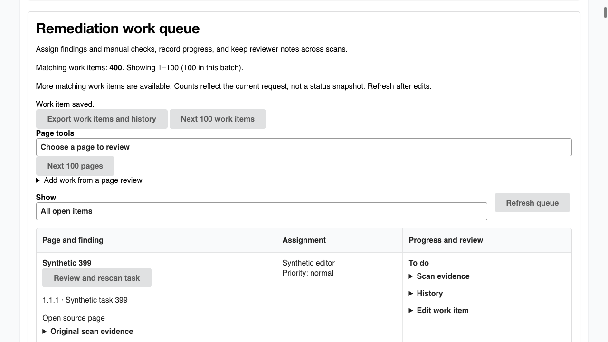

# LT-128 bounded queue discovery

Newest verified tasks no longer hide older open tasks. The registered queue GET
and real mounted queue now use the additive items-only `view=bounded-v2` contract.
It filters globally before count and batch selection, defaults to100/max100,
retains `_id DESC` and returns matching total/returned/hasMore/complete. Unknown
profiles, filters and malformed/swapped cursors are 400. Omitted-view clients keep
their original max 200/array/nextCursor behavior. A final continuation is not the
whole list. Mutable status/counts are request-observed, not a cross-request
snapshot; project/filter/edit changes reset UI traversal. Only 100 rows are kept.

A whole v2 response over 1 MiB fails explicitly with 413; no evidence is silently
shortened. Full authenticated streaming exports remain separate and complete.
`sectionID` retains its candidate-page meaning. Other conformance/history lists,
criterion review/signoff, current/stale/failed semantics, global digest, journals,
auth, signed operations and recovery are unchanged. Historical recovery-only UI
continues its independent legacy page/status read. Apply the series and read
`docs/remedy-queue-bounded.md` for the precise contract, indexes and operator
backup/upgrade/rollback guidance.

## Source and compatibility

| Target | Upstream pin | Initial 36-patch tree |
|---|---|---|
| Staging | `67301b35c3784ed73ba1a65011ef5a1d689abca1` | `56ae2bbc786b99ea85ce10201e392214622a96dd` |
| Released floor | `352a657ec6de7b317a70ad3f8f744bc6d5054d9d` | `efafc2966ec13a397ebff733473cd0ecf5147235` |

Use each complete `manifest-lt128.json` via the root README's fresh detached
checkout instructions. The published 35-patch `manifest-lt190.json`, every earlier
patch/candidate record and Server's `973fa92426814c43400a4ee031f3c854a1dc4933`
consumer rehearsal remain intact. New source-specific component candidates need
exact-head/main Linux execution, downloaded-byte verification and separate new
assembled-package acceptance. They never silently replace the accepted current
candidate index or inherit LT-197/LT-212 acceptance.

## Actual local evidence

The original route returned the newest 100 verified tasks and ignored the requested
status. The mounted red regression reported `expected null to be 'open'`. Both
were run red before implementation. Actual router tests now cover four distinct
100-row open batches behind those verified tasks, 0/1/100/101/205 populations,
all/single/open filters, malformed/repeated/structured parameters, invalid and
project/profile/filter-swapped cursors, creation fences, edits/refresh,
legacy 200, unauthorized access and explicit 413 with complete exports. Mounted
tests cover bounded replacement, filters, edit refresh, lazy history, delayed
project/filter responses and independent historical recovery. The initial new
recovery-view profile regression was also run red before correction.

[Local check counts](evidence/lt128/local-checks.json): staging 80 server/326
client/101 authenticated route-Mongo tests; release 50/233/101. Both client/server
builds pass with unchanged lockfiles and Node 22. Standalone server typecheck still
has 60 inherited diagnostics; complete baseline-relative comparison is a required
Linux gate, not a standalone pass. No TestSprite or Kodus run was performed.

[Actual built product browser observations](evidence/lt128/browser-proof.json)
show 400 distinct older task titles across four 100-row batches with only 100 rows
mounted, complete 100-row Verified versus incomplete 500-row All, explicit edit
refresh and lazy 100-row history. Normal local login, JWT sessions and Mongo are
real. Only external readiness is a loopback health fixture; third-party browser
requests are denied with a self-only CSP. This is component UI verification,
not full owned-stack/provider/SSO certification. Pointer/selector and fixture
setup failures were retained and not counted as successful observations. A
valid pre/post check confirms a task edit leaves the global conformance digest
unchanged and status `verification_pending`.



## Measurements and limits

[Route measurements](evidence/lt128/route-measurements.json) retain 20 serial warm
samples' summaries, cold definitions, bytes, complete oracle/export checks and
journal SHA. Host is macOS arm64/M2 Max, Node 22.20.0, Mongo 7.0.14, real registered
router/bcrypt/JWT/project permission. HTTP latency includes body read/JSON parse;
driver row sizing is a separate invocation. These are local fixtures, not a
concurrency benchmark or deployment SLA.

| Actual route | Staging warm p95 | Release warm p95 | Bytes |
|---|---:|---:|---:|
| authenticated-queue-v2-open | 119.36 ms | 117.84 ms | 46942 / 46942 |
| authenticated-queue-v2-all | 120.68 ms | 120.45 ms | 47340 / 47340 |
| authenticated-queue-v2-verified | 118.74 ms | 117.89 ms | 47140 / 47140 |

Both target probes preserve the 500-page full oracle, all 125k review records plus
scope, all 500 work items and 125k history events in complete authenticated exports.
Summary bytes remain 193,390 in the mixed fixture. The staged 125k growth run
recorded a 1,069.56ms p95 miss against the 1s growth signal; release measured 815.69ms.
The miss is retained, not waived or used to justify a selector rewrite. At the
approved 25k fixture both summaries remain below 326 ms.

[Separate-process memory/latency](evidence/lt128/staging-isolated-memory2.json)
excludes fixture/oracle/client allocation from server memory. It measured queue
p95 about 63ms and 125k summary p95 about 510ms, a different fresh-process run.
The first queue window's sampled RSS increment was about 181MiB, above the proposed
128 MiB diagnostic target; later windows added about 1 MiB or less. Retained heap
change was about 0.82 MiB for that first window. Keep this memory miss and the
shared-host/GC/2ms-sampling caveats; no portable hard memory ceiling is claimed.
No rows, notes or review semantics were truncated to improve these figures.

[Real execution plans](evidence/lt128/index-trial-plans.json) justified the two
non-unique indexes: creation-fence counts use 0 document fetches instead of 500;
verified batch fetches 100 instead of 500. Open batch remains 201 examined docs.
The index trial occurred during implementation before schema declarations; final
source initializes the validated indexes when explicitly enabled. No arbitrary
hint or live migration was used. Index storage/build/backup privileges remain
operator concerns; disabled Remedy still initializes no optional storage.

## Repeat safely

Use a fresh patched checkout, Node 22, installed unchanged server lockfile and an
owned loopback Mongo database whose empty name starts `conductor_test_lt128_`.
The benchmark refuses a nonempty database and any provider HTTP. It retains the
synthetic database; it does not deploy, push or erase a live dataset.

Copy [queue-benchmark.ts](evidence/lt128/queue-benchmark.ts) into that checkout's
`server/scripts/lt128QueueBenchmark.ts`, then from `server` run:

```sh
CONDUCTOR_TEST_MONGO_URI=mongodb://127.0.0.1:27130/conductor_test_lt128_repeat \
  LT128_OUTPUT=/tmp/lt128-queue-repeat.json \
  node --expose-gc --import tsx scripts/lt128QueueBenchmark.ts
```

Final-source repeats start with the indexes present. The original before/after
index trial is retained separately. For the separate-process probe, copy
[isolated-memory.ts](evidence/lt128/isolated-memory.ts) beside the benchmark,
use its resulting fixture DB and an unused owned loopback 41828. Its normal local
login rotates only the synthetic fixture editor's password and never prints it.
Use the supplied [strict loopback guard](evidence/lt128/memory-loopback-only.cjs)
through NODE_OPTIONS when running this cross-process probe; it admits only its
Mongo and exact owned listener port. The normal CI loopback guard is unchanged.
Move private fixture scripts out of the product compiler inputs before standalone
checks; they are test harnesses, not shipped Conductor modules. No compiler
exclusion, skipLibCheck or diagnostic suppression is authorized.

Actual compiled head/main results, source-specific candidate records, review
counts/dispositions and cleanup are returned with the final handoff. The five
production deployment/write/provider/SSO/release-owner flags remain false.
LibreTexts integration/deployment owns vendor conditional-write validation,
write enablement and rollout timing. No new assembled package acceptance is
claimed by this component change.

## Review scope and legacy exception

LT-128 is the focused correctness hotfix for confirmed task-discovery failure,
as authorized by the latest Chief decision (queue GET and mounted filter/paging
only). The touched legacy loader retains its existing transport/rendering pattern
under upstream README Client standards' explicit “unless you're only hotfixing”
exception. This is not an exemption for new general UI work. Migrating all queue
actions/history into typed API methods and React Query is a separate architecture
slice; it is unnecessary to restore discovery and would broaden this hotfix.
The shared LT-190 capability query remains unchanged. Native Standards raised
this conditional minor; the explicit existing exception is the disposition.
